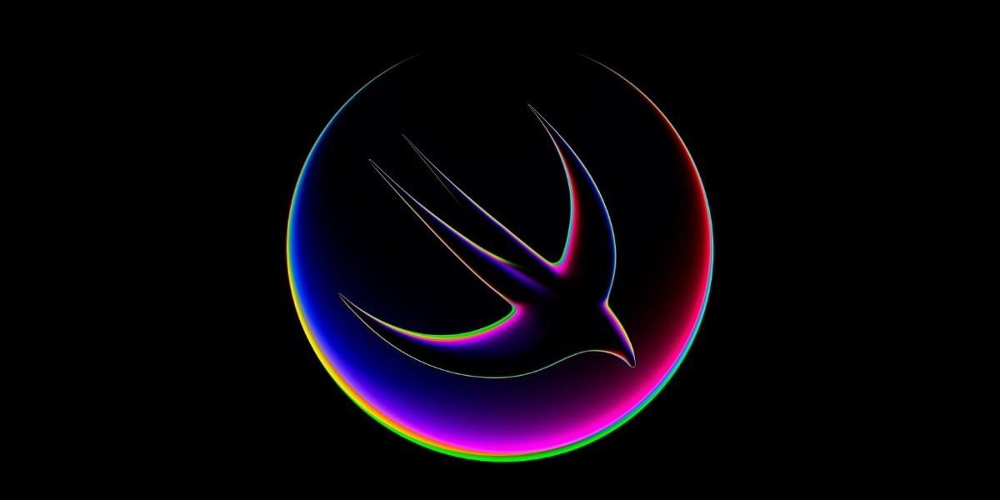

# WWDC 2023 - Swift Student Challenge

List of student submissions for the WWDC 2023 - Swift Student Challenge. The list is in alphabetical order.

### How to add your submission?
1. **[Click here to open the form](https://github.com/wwdc/2023/issues/new?template=submit.yml)** and fill it in.
2. Send it. A bot checks your entry within a minute and tells you if anything needs fixing. You can edit the form after sending.
3. When it is approved your entry appears on this list.

#### How to update or remove your submission?
Use the **[update form](https://github.com/wwdc/2023/issues/new?template=update.yml)**. Only the person who sent the entry can change it.

### Submissions

| Participant | Links  | Status |
|:--|:--|:--|
| [Alex Cucos](https://github.com/skiezest) | [GitHub](https://github.com/skiezest/Learn-Morse) SwiftUI, AVKit |  |
| [Alperen Örence](https://github.com/alperenorence) | [GitHub](https://github.com/alperenorence/HandSignal) SwiftUI, CoreML |  |
| [Amelia While](https://github.com/elihwyma) | [GitHub](https://github.com/elihwyma/WWDC2023-Semaphores) UIKit, AVFoundation, Vision |  |
| [Arjun Balakrishnan](https://github.com/balkarjun) | [GitHub](https://github.com/balkarjun/Ciphers) SwiftUI |  |
| [Bill Chen](https://github.com/billchen2k) | [GitHub](https://github.com/billchen2k/HiSynth) SwiftUI, AVFoundation, SpriteKit |  |
| [Bryan](https://github.com/bryanless) | [GitHub](https://github.com/bryanless/Assembly-Playground) SwiftUI |  |
| [Carlos Mbendera](https://github.com/carlosmbe) | [GitHub](https://github.com/carlosmbe/Rhythm-Snap) SwiftUI, Vision, AVFoundation |  |
| [Chenshuhao Qin](https://github.com/CodyQin) | [GitHub](https://github.com/CodyQin/Ferryman-Puzzle) SwiftUI |  |
| [Chongin Jeong](https://github.com/chongin12) | [GitHub](https://github.com/chongin12/Sometimes) · [Video](https://www.youtube.com/watch?v=qT3PcCvPN44) SwiftUI, AVFoundation, SpriteKit |  |
| [Daniel Aprillio](https://github.com/Nielioo) | [GitHub](https://github.com/Nielioo/Spectrum) SwiftUI, AVFoundation |  |
| [Daniel Riege](https://github.com/danielriege) | [GitHub](https://github.com/danielriege/WWDC23-Submission) simd, SceneKit, SwiftUI |  |
| David Mazzeo | [GitHub](https://github.com/TheIntelCorei9/Swift-Student-Challenge-23) · [Video](https://www.youtube.com/watch?v=ViGDWfh0ViA) simd, SceneKit, SwiftUI |  |
| [Dayeon Moon](https://github.com/dayo2n) | [GitHub](https://github.com/dayo2n/WWDC23-Swift-Student-Challenge) · [Video](https://www.youtube.com/watch?v=NY2yq6vh-M0&t=3s) SwiftUI |  |
| [Dishant Nagpal](https://github.com/Dishant10) | [GitHub](https://github.com/Dishant10/ColorFun) · [Video](https://youtu.be/ozhgQj-HvBE) SwiftUI, ARKit, SceneKit, AVFoundation |  |
| [Dohyun Kim](https://github.com/a-mystic) | [GitHub](https://github.com/a-mystic/WWDC2) SwiftUI, UIKit, ARKit, RealityKit +1 |  |
| Dominick Pelaia | [GitHub](https://github.com/Cheezum32/EggDrop) · [Video](https://www.youtube.com/watch?v=2w7_TJHBdqE&t=6s) SwiftUI, SpriteKit, UIKit, OpenGL |  |
| [Euiseo Park](https://github.com/kpk0616) | [GitHub](https://github.com/kpk0616/Gestalt) SwiftUI, MVVM |  |
| [Farid Azhari](https://github.com/bukanfarid) | [GitHub](https://github.com/bukanfarid/motoLean) SwiftUI, CoreMotion |  |
| [Frank Chu](https://twitter.com/cyongfrank) | [GitHub](https://github.com/yongfrank/regexgo) · [Video](https://www.youtube.com/watch?v=nNWsuZMPHtk) Swift Regex, RegexBuilder |  |
| Fred P | [GitHub](https://github.com/fredpi/WWDC2023) SwiftUI, UIKit, SceneKit, ARKit |  |
| [Freddie Nicholson](https://fr3ddie.me/) | [GitHub](https://github.com/FreddieN/Bouncer-WWDC23) · [Video](https://youtu.be/XSjS0nZrEhQ) SwiftUI, ARKit, SceneKit, CoreMotion |  |
| [Gabriel Zhang](https://github.com/SLED-5) | [GitHub](https://github.com/SLED-5/Remember-Me) SwiftUI, SpriteKit, AVKit |  |
| [Gokul R Nair](https://twitter.com/itIsGokulNair) | [Source](https://twitter.com/itIsGokulNair) SwiftUI |  |
| [Gyuri Park](https://github.com/GYURI-PARK) | [GitHub](https://github.com/GYURI-PARK/WWDC2023) SwiftUI, SpriteKit |  |
| [Henri Bredt](https://twitter.com/henricreates) | [GitHub](https://github.com/henribredt) · [Video](https://www.youtube.com/watch?v=0ZGPRZ1uUi0) SwiftUI |  |
| [JiaXiang Lu](https://github.com/sdfsdfsv) | [GitHub](https://github.com/sdfsdfsv/The-Mountain-Wwdc23) SwiftUI, MetalKit |  |
| [Jinha Byeon](https://github.com/Byeonjinha) | [GitHub](https://github.com/Byeonjinha/MyStarryCompanion) · [Video](https://www.youtube.com/watch?v=9WZQ4pwnIjo) SwiftUI |  |
| [John Seong](https://johnseong.info) | [GitHub](https://github.com/wonmor/Atomizer-Swift-Challenge) · [Video](https://www.youtube.com/watch?v=kHcdvyaqslU) SwiftUI, SceneKit, ARKit, Vision |  |
| [Jonathan](https://fuzzynat26.github.io/personal/) | [GitHub](https://github.com/FuzzyNat26/light-pollution) SwiftUI, AVFoundation |  |
| [Jong Myeong Ha](https://github.com/hhajime) | [GitHub](https://github.com/hhajime/Sensit-WWDC-2023-Swift-Student-Challenge) SwiftUI, AVFoundation, Accerate, Combine |  |
| [Jose Adolfo Talactac](https://twitter.com/devjoseadolfo) | [GitHub](https://github.com/devjoseadolfo/LogicBoard) · [Video](https://youtu.be/Pg_R5nvF2Tw) SwiftUI, SpriteKit, UIKit |  |
| [José María PF](https://github.com/clxsrdev) | [GitHub](https://github.com/clxsrdev/Mixin-UP) · [Video](https://youtu.be/qkMU5xHEZ_8) SwiftUI |  |
| [JUI-LIN, YU](https://github.com/kr1s0404) | [GitHub](https://github.com/kr1s0404/WWDC2023-The-Secret-Message) SwiftUI |  |
| [Junaid Abdurahman](https://twitter.com/junaidxabd) | [Video](https://youtu.be/k2dujM3D47M) UIKit |  |
| [Juraj Kebis](https://github.com/vector23) | [GitHub](https://github.com/vector23/Planties) SwiftUI, SpriteKit, UIKit |  |
| [Kwansik Nam](https://github.com/snacknam) | [GitHub](https://github.com/snacknam/WWDC23-SSC) SwiftUI |  |
| [Kyoya Yamaguchi](https://github.com/kyoya1123) | [GitHub](https://github.com/kyoya1123/Newtons-Notebook) · [Video](https://youtu.be/2dCPEKDxhkY) PencilKit, SpriteKit |  |
| [Leon Böttger](https://github.com/leonboe1) | [GitHub](https://github.com/leonboe1/Bounce) SwiftUI |  |
| [Martin Maly](https://x.com/mountain_mal) | [GitHub](https://github.com/martinmaly21/BreathPlay-WWDC) · [Video](https://youtu.be/WB53KNZX9jo) SwiftUI, SceneKit, AVFoundation |  |
| [Myung Geun Choi](https://github.com/mgdgc) | [GitHub](https://github.com/mgdgc/earth-debugger) · [Video](https://youtu.be/prc4jeNdFfA) SwiftUI |  |
| [Nyoman Adiwinanda](https://github.com/NyomanAdiwinanda) | [GitHub](https://github.com/NyomanAdiwinanda/WWDC23-SwiftChallenge) SwiftUI |  |
| [Omar Abu Sharar](https://github.com/omarabusharar) | [GitHub](https://github.com/omarabusharar/ssc-2023) · [Video](https://www.youtube.com/watch?v=aL7OD8BxTJ8) SwiftUI, SpriteKit |  |
| [Paulo César de Lima Rocha](https://github.com/Nyffi) | [GitHub](https://github.com/Nyffi/WWDC23-SwiftStudentChallenge) SwiftUI, SpriteKit |  |
| [Pedro Henrique Ceccon](https://github.com/PedroCeccon) | [GitHub](https://github.com/PedroCeccon/WWDC23) SwiftUI |  |
| [Peter Yaacoub](https://github.com/Yaacoub) | [GitHub](https://github.com/Yaacoub/Swift-Student-Challenge/tree/main/WWDC%202023) · [Video](https://youtu.be/4BUhhSCweqc) AVFoundation, CoreGraphics, SpriteKit, SwiftUI |  |
| [René Martínez Villaseñor](https://github.com/dmcpacks) | [GitHub](https://github.com/dmcpacks/mexicoclicker) · [Video](https://www.youtube.com/watch?v=9eQXIoK-RDg) SwiftUI, AVFoundation, AVKit |  |
| [Rexan Wong](https://linktr.ee/rexanwong) | [GitHub](https://github.com/RexanWONG/PhotoRush) SwiftUI, CoreML, Vision |  |
| [Riccardo Persello](https://github.com/persello) | [GitHub](https://github.com/persello/ssc23) Accelerate, AVFoundation, SwiftUI, Vision |  |
| [Rithul Kamesh](https://github.com/rithulkamesh) | [GitHub](https://github.com/rithulkamesh/fitness) SwiftUI |  |
| [Samion Suwito](https://github.com/isitusnoamow) | [GitHub](https://github.com/isitusnoamow/cells-wwdc2023) SwiftUI, SpriteKit, CoreGraphics |  |
| [Seokho Lee](https://github.com/Mercen-Lee) | [GitHub](https://github.com/Mercen-Lee/Allergist) SwiftUI |  |
| [Syed Aabis Akhtar](https://github.com/gitbolt) | [GitHub](https://github.com/gitbolt/asymmed) SwiftUI, CryptoKit |  |
| [Tanmay Goel](https://github.com/tanmayg1502) | [GitHub](https://github.com/tanmayg1502/Diffie-Hellman-Key-Swift-Playground) SwiftUI |  |
| [Thomas Wegele](https://github.com/thomas-w12) | [GitHub](https://github.com/thomas-w12/OperationalAmplifiers) · [Video](https://www.youtube.com/watch?v=qPVmeU7zCaI) SwiftUI |  |
| [Ungjae Lee](https://github.com/NuPlay) | [GitHub](https://github.com/NuPlay/DropUI) SwiftUI, PencilKit |  |
| [Vedant Malhotra](https://github.com/vedantapps) | [GitHub](https://github.com/vedantapps/slidescramble) · [Video](https://youtu.be/hImUT1NZHp8) SwiftUI, UIKit, ARKit, PencilKit |  |
| [Vincent Cai](https://www.instagram.com/vince14genius_0/) | [GitHub](https://github.com/Vince14Genius/My-WWDC-Swift-Student-Challenge-submissions) SwiftUI |  |
| [Won Geun Yu](https://github.com/Ryujin1210) | [GitHub](https://github.com/Ryujin1210/WWDC2023_EyeingArt) SwiftUI, UIKit, ARKit, SceneKit |  |
| [Woowon Kang](https://github.com/mosiccan) | [GitHub](https://github.com/mosiccan/setup-tennis-racket) SwiftUI |  |
| [Xianhao Liu](https://github.com/Carton22) | [GitHub](https://github.com/Carton22/Handbot) · [Video](https://youtu.be/AQyzqk6_YjY) SwiftUI, UIKit, PencilKit, AVFoundation |  |
| [Yanan Li](https://github.com/liyanan2004) | [Video](https://youtu.be/2CStbcJK0qM) SwiftUI, Swift Charts |  |
| [Yi Cao](https://github.com/xiaoyu2006) | [GitHub](https://github.com/xiaoyu2006/IFS) SwiftUI, UIKit |  |
| [Yujin Lee](https://github.com/yujinnee) | [GitHub](https://github.com/yujinnee/WorldHunter) · [Video](https://www.youtube.com/watch?v=rlxRgopwPkE) SwiftUI, UIKit, SceneKit, ARKit |  |
| [Yunho Oh](https://github.com/helloyunho) | [GitHub](https://github.com/helloyunho/sound-playgrounds) SwiftUI, AVFoundation |  |

##### Total: 64 | Awarded: 48
